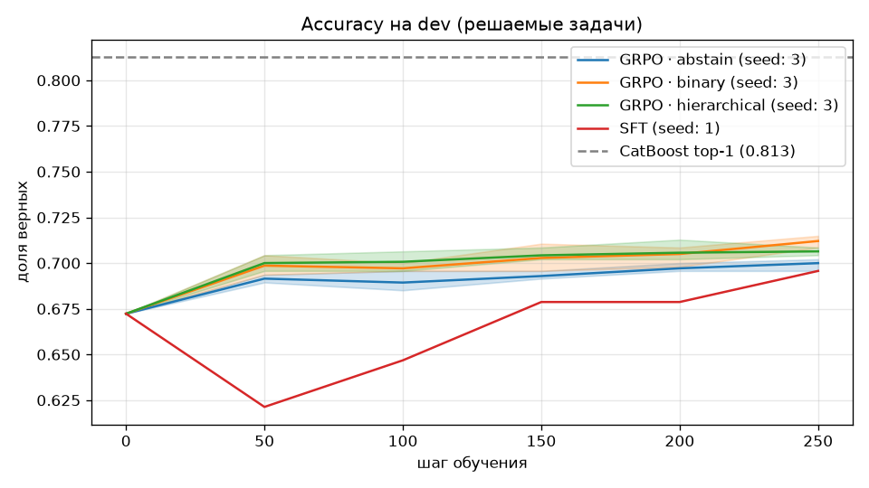
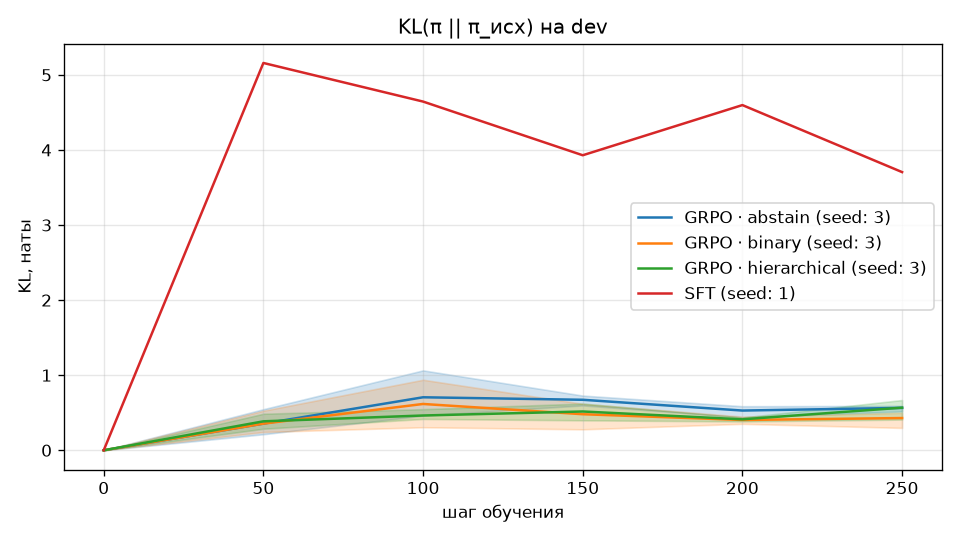
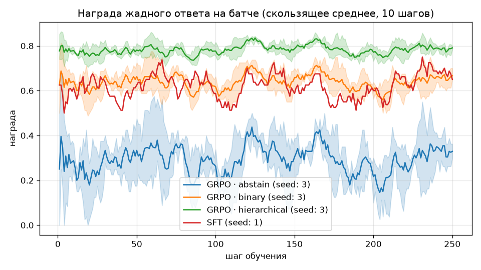
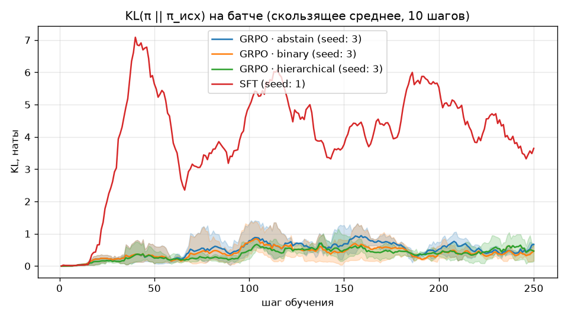
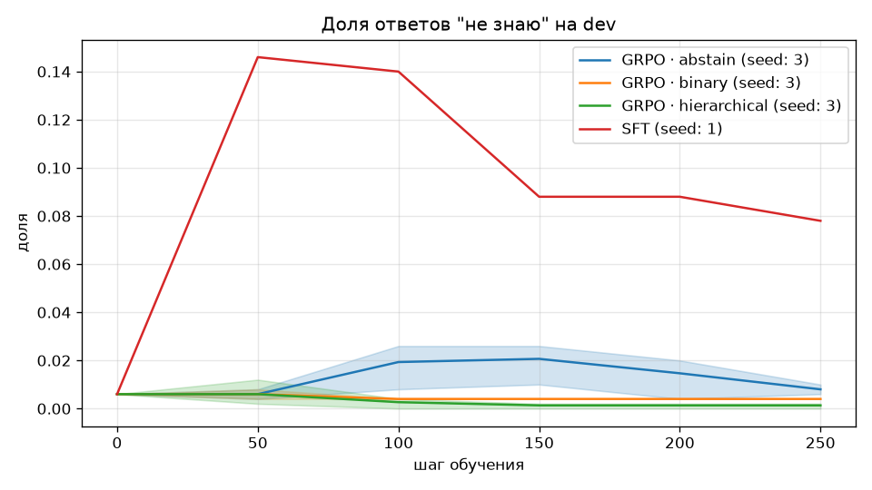
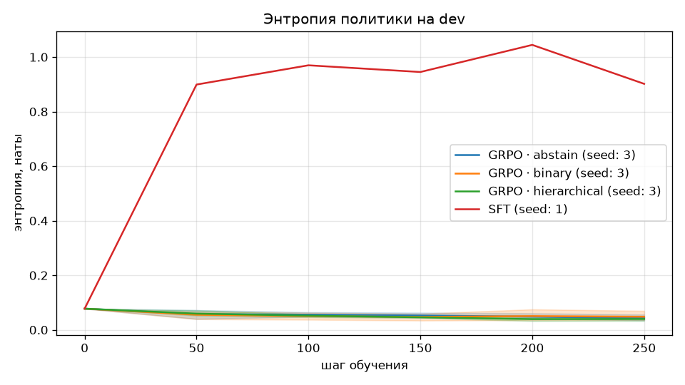

# Трек 3. RL-дообучение языковой модели
# LLM-судья поверх каскада: как награда меняет поведение модели при GRPO

## Содержание
1. [Вопрос, гипотезы и почему такая постановка](#1-вопрос-гипотезы-и-почему-такая-постановка)
2. [Задача, данные, алгоритм, условия и метрики](#2-задача-данные-алгоритм-условия-и-метрики)
3. [Код, seed и запуск](#3-код-seed-и-запуск)
4. [Графики обучения и итоговая таблица](#4-графики-обучения-и-итоговая-таблица)
5. [Ответы моделей до и после обучения](#5-ответы-моделей-до-и-после-обучения)
6. [Анализ](#6-анализ)

## 1. Вопрос, гипотезы и почему такая постановка
### Общее описание задачи:
Задача RL реализована как часть ВКР. Сама ВКР описана на [karsakov.dev](https://www.karsakov.dev). 
Коротко, по фактам:
- соотносим "грязное" название строй.материала от организации с одним из 75к классов иерархического справочника.
- Пример:
```python
# позиция от организаций:
'2342300003451 Проф. для г/к пот. 27*28*0,5 упаковка 20 листов, Россия'
# То что в справочнике:
код: '1/10-230-55-20/115' 
наименование: 'Профиль для гипсокартона потолочный - пристенный UD (ПН) 27 х 28, 0,5 мм'

Задача: "закодировать" все позиции от организаций
```

Пайплайн: 
- нормализация
- три генератора кандидатов (TF-IDF+SGD, BM25, дообученный e5) собирают пул из 60–80 кодов (по 30 каждый, но минус дубликаты и т.п.)
- CatBoost их ранжирует. 
- Верный код попадает в пул в 97% случаев, но первым CatBoost ставит его только в 68%. 
- кандидаты очень хорошие и не хватает нормального судьи

Идея: роль судьи сыграет LLM - он получает позицию и пять лучших кандидатов CatBoost и отвечает цифрой.

Qwen3-4B-Instruct-2507 взята потому что русские технические названия мелким моделям даются плохо

----------
```
В центре работы должен быть исследовательский вопрос с количественной проверкой и заранее неочевидным ответом. До начала обучения зафиксируйте:

Исследовательский вопрос. Что именно вы хотите выяснить?
Гипотезу. Какой результат вы ожидаете и почему?
Метрику. По какому числу или графику вы сделаете вывод?
План сравнения. Какие условия вы сравните и какой фактор будете менять?
```
### Исследовательский вопрос и гипотезы
**Вопрос.** Как устройство награды влияет на то, что выучивает судья? Сравниваются
три награды, всё остальное: данные, промпт, модель, бюджет шагов, оценка — одинаковое.
- **binary** (базовое условие) — 1 за верный код, за всё остальное(включая "не знаю") - 0.
- **hierarchical** — за верный код 1, за неверный - частичный кредит, пропорциональный
  общей части пути по дереву справочника. Сосед по ветке получает 0.5.
- **abstain** — +1 за верный, 0 за "не знаю", −1 за ошибку. При таком штрафе отвечать
  выгодно, если модель уверена больше чем на 50%

Отдельно на тех же данных, как контроль, обучается sft - если grpo с binary даёт то же самое что обычное обучение с учителем, то это тоже ответ.

**Гипотеза 1(hierarchical)** Частичный кредит поднимет долю ответов "в той же ветке", но accuracy не вырастет, а может даже и упадёт. Причина в том, что сиблинги -труба 57х3,5 и труба 76х3,5 почти идентичные и модели проще научиться попадать в ветку чем разбирать размеры. 

**Гипотеза 2(abstain)** Модель научится говорить "не знаю" в первую очередь там, где верного кода среди пяти вариантов действительно нет (таких задач около 11%).Точность среди тех ответов, которые она всё-таки дала, будет выше accuracy binary,
ценой покрытия. С ВКР это прямо связано с ярусами уверенности T1–T4: там решение "отдать человеку" сейчас принимается порогом по скору CatBoost.

### Постановка и отличия от задания:

- 1.Модель больше 1.5B. Qwen3-0.6B на отладке выбирала почти наугад, 12.9% верных при случайных 16.7%, и больше половины ответов у неё были "0". Поэтому Qwen3-4B, но с LoRA.
- 2.базовая accuracy 0.676, вместо "10–50%" по заданию - здесь сложность задают сами данные, и подогнать её можно было бы только выкидыванием задач. Расти есть куда — CatBoost на этих же задачах даёт 0.822, потолок 1.0.

## 2. Задача, данные, алгоритм, условия и метрики

### Промпт и ответ

Модель видит нормализованное название позиции с единицей измерения и пять кандидатов: название класса из справочника и его единицу. Шестой вариант всегда "0. Ни один вариант не подходит". У 33 тыс. кодов из данных организаций своего названия в справочнике нет, для них показываем пример из train каскада.

Кандидатов перемешиваем, чтобы модель не выучила кэтбустовский порядок - это 68% верных. Перестановка у каждой задачи своя, но фиксированная, так что все модели видят один и тот же промпт.

Ответ - одна цифра 0..5, thinking выключено . Награда считается в `rewards.py` по выбранному и верному коду (код фактически это ветвь в дереве. Например: `1/10-230-60-5/100` значит
- раздел 1 - строй материалы, 
- подраздел 10 - строй.мат. общего назначения
- 230 - для отделочных работы
- 60 - Сухие смеси, пастовые составы
- 5 - гидроизоляционные сухие смеси
)

### Данные

Выгрузку делает `scripts/export_judge_dataset.py` в репозитории ВКР. Обученный каскад прогоняется по своей val-части, которую не видел ни один его компонент, и на каждую позицию сохраняются верный код и 10 лучших кандидатов CatBoost. В файле только нормализованный текст, коды, названия классов и единицы.

Основные прогоны идут на `data/full_val.jsonl`: 12 825 позиций, top-1 CatBoost 0.742, верный код в top-5 у 90.8%. `data/proxy_val.jsonl` (2 241 позиция) остался с отладки.

Разбиение фиксированное (`split_seed: 42`): сортировка по хэшу id, дальше отложенная выборка 2 000, dev 500 и train 10 325. Одна особенность. Уникальна пара (текст, код), а не текст, и примерно 12% строк - одна и та же позиция, которую организации закодировали по-разному. "доска необрезная т.19.22 мм 1 сорт" есть и с кодом `.../25`, и с `.../125`. Промпт у них одинаковый, верно ответить можно только на одну. Для CatBoost этот потолок тот же. id - хэш текста, поэтому такие дубли всегда лежат в одной части разбиения.

### Алгоритм: GRPO для ответа из одного токена

Обычный GRPO генерирует на промпт G ответов, раздаёт награды и сравнивает каждый со средним по группе: advantage = (r - mean) / std. Вероятность ответов лучше среднего растёт, хуже - падает, а штраф за KL к исходной модели не даёт уйти далеко.

У нас ответ один токен, так что генерировать G раз незачем. Модель один раз читает промпт, из логитов цифр получается распределение по шести вариантам, и из него сэмплируются восемь ответов группы. Обновление одно на порцию сэмплов, отношение новой и старой политики равно единице, и PPO-клиппинг ничего бы не делал. Его и нет. KL считается точно, суммой по шести вариантам. Цикл свой (`grpo.py`, `train.py`), без `trl`: `GRPOTrainer` прогонял бы промпт G раз.

Обучается LoRA rank 16 во всех линейных слоях, 33 млн параметров из 4 млрд, на MLX. Референс для KL - исходная модель. Её распределения считаются один раз и только по промптам, которые попадут в батчи (за 250 шагов по 8 это ~2 тыс. из 10).

С learning rate пришлось повозиться. Привычные для LoRA 1e-5...1e-4 ломают модель за один шаг: Adam сдвигает каждый параметр примерно на величину шага, и решение на одном токене к этому очень чувствительно. На Qwen3-0.6B один шаг SFT при 2e-5 дал KL около 3 нат, при 1e-6 уже 0.15, при 3e-7 всего 0.006. Остановились на 3e-7 и kl_coef 0.05, на 4B проверили коротким прогоном на 40 шагов.

### Условия и метрики

Условия перечислены в разделе 1: три награды и SFT-контроль.

**Метрики.** Главная — accuracy на отложенной выборке, на решаемых задачах (верный код есть среди 5 кодов). Рядом с ней смотрим долю ответов в той же ветке, долю "не знаю", точность среди данных ответов, долю "не знаю" на нерешаемых задачах, согласие с CatBoost, энтропию политики и KL к исходной модели. Всё по шагам обучения и в итоговой таблице, с разбивкой по срезам `only_reference / org_1_4 / org_5plus`.

**План сравнения.** Три награды * три seed (0, 1, 2) плюс SFT, одинаковые 250 шагов
по 8 промптов. Оценка у всех одна: жадный ответ на одних и тех же 2 000 задачах,
которые в обучение не попадают. Эту выборку модель видит только дважды, до обучения и
после последнего шага. Кривые по ходу обучения (accuracy, "не знаю", энтропия, KL к исходной модели) строятся на отдельной dev-выборке из 500 задач. Она тоже в обучение не попадает, но lr и kl_coef подбирались по ней, поэтому итоговые выводы делаются только по отложенной выборке. Чекпоинт не выбирается, берётся последний шаг.

## 3. Код, seed и запуск

```
config/default.yaml     все настройки, --set раздел.ключ=значение их переопределяет
data/                   выгрузка кандидатов (jsonl) и её паспорт (.meta.json)
runs/                   метрики и предсказания прогонов серии (без адаптеров)
docs/figures/           графики для раздела 4
src/rl_judge/
    config.py           конфиг
    data.py             задачи и разбиение
    prompt.py           промпт, перестановка кандидатов
    rewards.py          три награды
    model.py            Qwen на MLX, LoRA, вероятности цифр
    grpo.py             сэмплирование группы, advantage, loss GRPO и SFT, KL
    train.py            цикл обучения
    evaluate.py         жадная оценка и метрики
    report.py           графики и таблицы для README
    progress.py         прошло / осталось в логе
tests/                  pytest
```

Seed: разбиение и порядок кандидатов задаёт `data.split_seed: 42`, обучение `train.seed` = 0, 1, 2 (инициализация LoRA, порядок батчей, сэмплирование). Версии зависимостей в `uv.lock` и `requirements-freeze.txt` (это pip freeze).

Нужен Mac на Apple Silicon (MLX), Python 3.12 и `uv`. На M5 Max один прогон идёт около 40 минут, вся серия около 6 часов.

```bash
uv sync
uv run pytest
uv run hf download Qwen/Qwen3-4B-Instruct-2507

# проверочный прогон на 40 шагов
uv run python -m rl_judge.train --set experiment=check4b --set train.steps=40 --set train.eval_every=10

# серия: три награды * три seed и SFT
for reward in binary hierarchical abstain; do
  for seed in 0 1 2; do
    uv run python -m rl_judge.train --set experiment=${reward}_s${seed} \
      --set reward.name=$reward --set train.seed=$seed
  done
done
uv run python -m rl_judge.train --set experiment=sft_s0 --set train.method=sft

# графики в docs/figures, таблицы разделов 4-6 печатаются в консоль
uv run python -m rl_judge.report runs/*_s?
```

Обучать заново для отчёта не нужно: последняя команда работает по тому, что уже лежит в `runs/`.

## 4. Графики обучения и итоговая таблица

Отложенная выборка, 2 000 задач, из них 1 808 решаемых (верный код среди пяти). Ответ жадный, шаг последний. У GRPO среднее ± std по трём seed, у SFT seed один. Accuracy и "та же ветка" считаются на решаемых задачах, остальное на всех.

| условие | seed | accuracy | та же ветка | "не знаю" | точность ответов | "не знаю" без верного | согласие с CatBoost | энтропия | KL к исходной |
|---|---|---|---|---|---|---|---|---|---|
| базовая модель | — | 0.676 | 0.816 | 0.011 | 0.618 | 0.021 | 0.652 | 0.065 | 0.000 |
| CatBoost top-1 | — | 0.822 | — | — | — | — | — | — | — |
| GRPO · abstain | 3 | 0.710 ± 0.003 | 0.828 ± 0.001 | 0.012 ± 0.004 | 0.649 ± 0.003 | 0.021 ± 0.010 | 0.670 ± 0.001 | 0.048 ± 0.006 | 0.533 ± 0.049 |
| GRPO · binary | 3 | 0.710 ± 0.004 | 0.833 ± 0.003 | 0.006 ± 0.001 | 0.646 ± 0.004 | 0.007 ± 0.003 | 0.671 ± 0.001 | 0.049 ± 0.008 | 0.407 ± 0.109 |
| GRPO · hierarchical | 3 | 0.710 ± 0.004 | 0.831 ± 0.001 | 0.002 ± 0.001 | 0.643 ± 0.003 | 0.000 ± 0.000 | 0.667 ± 0.004 | 0.042 ± 0.004 | 0.635 ± 0.255 |
| SFT | 1 | 0.696 | 0.807 | 0.052 | 0.664 | 0.151 | 0.685 | 0.923 | 3.874 |

Кривые ниже построены на dev (500 задач, в обучение не входят). Линия - среднее по seed, полоса - от минимума до максимума.








Награду между условиями сравнивать нельзя, шкалы разные: у abstain бывает -1, у hierarchical есть частичный кредит. Графика длины ответа нет, потому что длина всегда один токен (`completion_tokens: 1` в `metrics.jsonl`). Вместо неё смотрим энтропию и долю "не знаю".

## 5. Ответы моделей до и после обучения

Задачи из отложенной выборки, у каждого условия seed 0. Сначала идут задачи, где модели ответили по-разному, поэтому верных тут меньше, чем в среднем. ✓ верно, ✗ неверно, названия обрезаны.

| позиция | верный класс | базовая | GRPO · abstain | GRPO · binary | GRPO · hierarchical | SFT |
|---|---|---|---|---|---|---|
| клапан отсечной угловой du15 пласт. крышка | клапаны радиаторные регулирующие с ручным маховико | ✗ клапаны запорно-присоединительные rlv d15 мм угловые | ✗ клапаны запорно-присоединительные rlv d15 мм угловые | ✗ клапаны запорно-присоединительные rlv d15 мм угловые | ✗ клапаны запорно-присоединительные rlv d15 мм угловые | 0 (не знаю) |
| рсгп для стяжек цементная м100 пк2 f100 st-2 стб13 | растворы кладочные тяжелые цементные марки 100 | ✗ растворная смесь готовая к применению кладочная цементная ма | ✗ растворные смеси предварительного изготовления кладочные цем | ✗ растворные смеси предварительного изготовления кладочные цем | ✗ растворные смеси предварительного изготовления кладочные цем | ✗ растворные смеси предварительного изготовления кладочные цем |
| бетон тяжелый с крупностью заполнителя 5-20 мм кла | бетоны тяжелые с крупностью заполнителя более 5 до | ✓ бетоны тяжелые с крупностью заполнителя более 5 до 20 мм кла | ✓ бетоны тяжелые с крупностью заполнителя более 5 до 20 мм кла | ✓ бетоны тяжелые с крупностью заполнителя более 5 до 20 мм кла | ✓ бетоны тяжелые с крупностью заполнителя более 5 до 20 мм кла | 0 (не знаю) |
| планка снегозадержателя /0.5-пэ-ral9003 /01- | планка снегозадержателя снегоупор размером от 65x9 | ✗ планка снегозадержателя снегоупор размером от 65x95 мм до 70 | ✗ планка снегозадержателя снегоупор размером от 65x95 мм до 70 | ✗ планка снегозадержателя снегоупор размером от 65x95 мм до 70 | ✗ планка снегозадержателя снегоупор размером от 65x95 мм до 70 | ✗ планка снегозадержателя снегоупор размером от 65x95 мм до 70 |
| п/п тройник комб. вр 25x1/2 meerplast | тройник из полипропилена пп тип 3 с внутренней рез | ✗ тройник из полипропилена пп тип 3 с наружной резьбой dn25x1/ | ✓ тройник из полипропилена пп тип 3 с внутренней резьбой dn25x | ✓ тройник из полипропилена пп тип 3 с внутренней резьбой dn25x | ✓ тройник из полипропилена пп тип 3 с внутренней резьбой dn25x | ✓ тройник из полипропилена пп тип 3 с внутренней резьбой dn25x |
| радиатор лу 21-315 | радиаторы отопительные стальные панельные двухрядн | ✗ радиаторы отопительные стальные панельные двухрядные с двумя | 0 (не знаю) | ✗ радиаторы отопительные стальные панельные двухрядные с одним | ✗ радиаторы отопительные стальные панельные двухрядные с одним | 0 (не знаю) |
| рспи кладочная цементная м200 пк2 st-1 | растворные смеси предварительного изготовления кла | ✗ растворы кладочные тяжелые цементные марки 200 | ✗ растворы кладочные тяжелые цементные марки 200 | ✓ растворные смеси предварительного изготовления кладочные цем | ✗ растворы кладочные тяжелые цементные марки 200 | ✗ растворы кладочные тяжелые цементные марки 200 |
| форзиция европейская высота 0.4-0.7 м | саженцы кустарников лиственных пород красивоцветущ | 0 (не знаю) | 0 (не знаю) | 0 (не знаю) | ✗ саженцы кустарников хвойных пород высокорослые | 0 (не знаю) |
| крпу-175/35 | кирпич керамический рядовой пустотелый утолщенный  | ✗ кирпич силикатный лицевой утолщенный полуторный полнотелый м | ✗ кирпич силикатный рядовой утолщенный полуторный полнотелый м | ✗ кирпич силикатный рядовой утолщенный полуторный полнотелый м | ✗ кирпич силикатный рядовой утолщенный полуторный полнотелый м | ✗ кирпич силикатный рядовой утолщенный полуторный полнотелый м |
| конвектор новатерм нт-в-11/40/120 | конвекторы внутрипольные стальные с медно-алюминие | ✓ конвекторы внутрипольные стальные с медно-алюминиевыми тепло | ✓ конвекторы внутрипольные стальные с медно-алюминиевыми тепло | ✗ конвекторы внутрипольные стальные с медно-алюминиевыми тепло | ✓ конвекторы внутрипольные стальные с медно-алюминиевыми тепло | 0 (не знаю) |
| отвод пэ компресс dn20x90гр ру16 valfex | угольник 90 градусов из полипропилена пп тип 3 ном | 0 (не знаю) | 0 (не знаю) | 0 (не знаю) | ✓ угольник 90 градусов из полипропилена пп тип 3 номинальным d | 0 (не знаю) |
| бсгт с20/25 st-2 f150-f200 w8 фр 10-20 | бетон тяжелый с крупностью заполнителя более 10 до | ✓ бетон тяжелый с крупностью заполнителя более 10 до 20 мм кла | ✗ бетон тяжелый с крупностью заполнителя более 10 до 20 мм кла | ✗ бетон тяжелый с крупностью заполнителя более 10 до 20 мм кла | ✗ бетон тяжелый с крупностью заполнителя более 10 до 20 мм кла | ✗ бетон тяжелый с крупностью заполнителя более 10 до 20 мм кла |

Ошибки почти всегда одного рода. Модель берёт очень похожий класс, который отличается одним признаком: наружная резьба вместо внутренней, силикатный кирпич вместо керамического, раствор вместо растворной смеси. Иногда по тексту правильный ответ просто не угадать. Из "радиатор лу 21-315" не понять, сколько там рядов оребрения. В последней строке у позиции морозостойкость f150-f200, а в справочнике есть и класс с f200, и класс с f50-f150. Организация выбрала первый, обученные модели второй, и спорить тут сложно.

## 6. Анализ

Коротко: при нашем бюджете от устройства награды почти ничего не зависит. Все три варианта GRPO подняли accuracy с 0.676 до 0.710, seed дают разброс около 0.4 п.п., а между наградами разницы нет совсем. Обе гипотезы не подтвердились. Прирост над базовой моделью при этом реальный: стандартная ошибка accuracy на 1 808 задачах около 1 п.п., а прибавили 3.4.

### Гипотеза 1: hierarchical и "та же ветка"

Не подтвердилась. Доля ответов в верной ветке у hierarchical 0.831, у binary 0.833. Среди ошибок соседей по ветке почти столько же, сколько у binary:

| условие | ошибок | сосед по ветке | другая ветка | "не знаю" |
|---|---|---|---|---|
| базовая модель | 585 | 0.432 | 0.538 | 0.029 |
| GRPO · abstain | 524 | 0.407 ± 0.009 | 0.557 ± 0.010 | 0.036 ± 0.010 |
| GRPO · binary | 525 | 0.423 ± 0.002 | 0.554 ± 0.002 | 0.022 ± 0.002 |
| GRPO · hierarchical | 525 | 0.419 ± 0.006 | 0.574 ± 0.004 | 0.008 ± 0.002 |
| SFT | 549 | 0.366 | 0.497 | 0.137 |

Лазейки нет. След награды всё-таки виден, но в другом месте: hierarchical почти перестал говорить "не знаю", 0.2% ответов против 0.6% у binary. Так и должно быть, ведь за любую догадку в ветке он получает больше нуля, а за "не знаю" ровно ноль.

### Гипотеза 2: abstain и "не знаю"

Тоже не подтвердилась. Там, где верного кода среди пяти нет, abstain говорит "не знаю" в 2.1% случаев, ровно как базовая модель. Точность ответов 0.649 против 0.646 у binary.

### Почему награды не различаются

Похоже, дело не в наградах, а в том, что модель почти не исследует. Энтропия базовой 4B на этой задаче 0.065 ната, то есть она почти всегда уверена в ответе. Восемь ответов группы из такого распределения обычно одинаковые, и advantage у них нулевой. Градиент дают только 4–6% групп. За 250 шагов по 8 промптов это примерно сотня промптов на всё обучение.

При этом награды отличаются друг от друга только на редких ответах. "Не знаю" сэмплировалось в 0.6–2% случаев, так что награде abstain было почти не на чем учить. Да и воздерживаться при λ = 1 выгодно, только когда уверенность ниже 50%, а при такой энтропии это редкость. С иерархическим кредитом похожая история. Соседа лучше верного кода он не делает никогда, только смягчает штраф, если верный код и сосед попали в одну группу. Таких групп тоже мало.

### Что выучилось на самом деле

Выучилась в основном позиция. Кандидаты перемешаны, и верный ответ стоит на местах 1–5 примерно поровну. А базовая модель первый вариант недолюбливает:

| условие | на месте 1 | на месте 2 | на месте 3 | на месте 4 | на месте 5 |
|---|---|---|---|---|---|
| n задач | 353 | 370 | 322 | 382 | 381 |
| CatBoost top-1 | 0.816 | 0.819 | 0.876 | 0.783 | 0.824 |
| базовая модель | 0.462 | 0.797 | 0.748 | 0.720 | 0.653 |
| GRPO · abstain | 0.693 ± 0.017 | 0.774 ± 0.013 | 0.743 ± 0.013 | 0.690 ± 0.011 | 0.655 ± 0.020 |
| GRPO · binary | 0.648 ± 0.033 | 0.768 ± 0.003 | 0.747 ± 0.019 | 0.709 ± 0.010 | 0.680 ± 0.025 |
| GRPO · hierarchical | 0.696 ± 0.071 | 0.778 ± 0.008 | 0.733 ± 0.025 | 0.695 ± 0.009 | 0.651 ± 0.018 |
| SFT | 0.739 | 0.692 | 0.686 | 0.675 | 0.690 |

Какую цифру модель называет (все задачи):

| условие | "0" | "1" | "2" | "3" | "4" | "5" |
|---|---|---|---|---|---|---|
| базовая модель | 0.011 | 0.121 | 0.284 | 0.203 | 0.211 | 0.170 |
| GRPO · abstain | 0.012 ± 0.004 | 0.206 ± 0.008 | 0.252 ± 0.011 | 0.179 ± 0.009 | 0.189 ± 0.006 | 0.163 ± 0.007 |
| GRPO · binary | 0.006 ± 0.001 | 0.187 ± 0.015 | 0.249 ± 0.001 | 0.183 ± 0.013 | 0.201 ± 0.008 | 0.174 ± 0.009 |
| GRPO · hierarchical | 0.002 ± 0.001 | 0.209 ± 0.032 | 0.256 ± 0.008 | 0.178 ± 0.012 | 0.192 ± 0.005 | 0.164 ± 0.007 |
| SFT | 0.052 | 0.238 | 0.204 | 0.152 | 0.175 | 0.178 |

Базовая модель называет "1" в 12% ответов, хотя верный ответ там примерно в 20% задач. Когда он первый, она угадывает его в 46% случаев, на остальных местах в 65–80%. После GRPO, причём с любой наградой, "1" звучит в 19–21% ответов, и accuracy на первом месте поднимается до 0.65–0.70. На местах 2–5 почти ничего не поменялось. Если прикинуть: 353 задачи с приростом около 22 п.п. дают ~4 п.п. общей accuracy, минус небольшая потеря на втором месте. Получаются как раз наши +3.4.

Можно было бы сказать, что модель просто лучше поняла тексты. Но тогда рост был бы на всех местах, а он почти весь на первом. Проверить это можно и без обучения, если усреднить вероятности по нескольким перестановкам кандидатов. Этого мы не делали.

### SFT-контроль

SFT ведёт себя иначе. Accuracy у него ниже, 0.696, а на dev она сначала проседает до 0.62 (график accuracy выше). Зато только он научился говорить "не знаю" там, где верного нет: 15% против 0–2% у GRPO. И точность ответов у него лучшая, 0.664. Объяснение простое. SFT учится на правильной цифре напрямую, а у 9% обучающих задач правильная цифра "0". GRPO же должен сначала "0" сэмплировать, а это почти не случается. Платит SFT за это уходом от исходной модели: KL 3.9 ната против 0.4–0.6 у GRPO, энтропия 0.92 против 0.05. Seed у него один, так что это скорее наблюдение, чем вывод.

### Где судья сильнее CatBoost

Для ВКР это, наверное, самое полезное. Accuracy по срезам, то есть по числу примеров у верного класса в train каскада:

| условие | только эталон | 1–4 примера | 5+ примеров |
|---|---|---|---|
| n задач | 203 | 424 | 1181 |
| CatBoost top-1 | 0.729 | 0.731 | 0.870 |
| базовая модель | 0.773 | 0.750 | 0.633 |
| GRPO · abstain | 0.796 ± 0.003 | 0.785 ± 0.004 | 0.668 ± 0.004 |
| GRPO · binary | 0.788 ± 0.013 | 0.778 ± 0.002 | 0.671 ± 0.007 |
| GRPO · hierarchical | 0.800 ± 0.012 | 0.785 ± 0.003 | 0.668 ± 0.004 |
| SFT | 0.813 | 0.769 | 0.650 |

На редких классах судья обходит CatBoost, и даже базовая модель уже обходит. На частых сильно проигрывает, 0.67 против 0.87: там CatBoost опирается на историю кодирования, а по одному тексту её не восстановить. Выходит, судья не замена ранжировщику, а добавка к нему на хвосте.

### Reward hacking

Не нашли. Лазейки, которых мы ждали, не появились: у hierarchical не выросла доля ответов в той же ветке, у abstain не выросла доля "не знаю". Ошибки у всех трёх наград одного рода и часто на одних и тех же задачах (раздел 5).

### Ограничения

- Бюджет маленький: 250 шагов по 8 промптов, и сигнал дают ~5% групп. Вывод "награда не важна" относится к этому бюджету и к почти детерминированной модели, а не к GRPO вообще.
- У SFT один seed. Штраф в abstain проверен только один, λ = 1.
- lr и kl_coef подбирались на 0.6B и коротком прогоне 4B по dev, а не под каждое условие отдельно.
- Судья видит только пять кандидатов, так что выше 90.8% (доля задач с верным кодом в top-5) ему не подняться. Около 12% строк к тому же дубли с разными кодами.
- Классы, которые известны только по данным организаций, подписаны примером из train каскада. Такие названия сами "грязные", и на них судье заведомо труднее.

### Что проверить дальше

1. Заставить модель исследовать: сэмплировать группу с температурой выше 1, добавить бонус за энтропию или учиться только на промптах, где ответы в группе разошлись (dynamic sampling, как в DAPO). Если награды после этого начнут различаться, значит, всё упиралось в исследование.
2. Перебрать λ для abstain. При λ = 3 отвечать выгодно только с уверенностью выше 75%. Это можно сравнить с порогами ярусов T1–T4 в ВКР.
3. Усреднить ответы базовой модели по нескольким перестановкам кандидатов, без всякого обучения. Если это даст те же +3 п.п., RL здесь в основном лечил позицию.
4. Маршрутизатор между CatBoost и судьёй: брать ответ судьи на редких классах. На инференсе для этого есть признак - сколько train-примеров у кандидата, которого CatBoost поставил первым.
