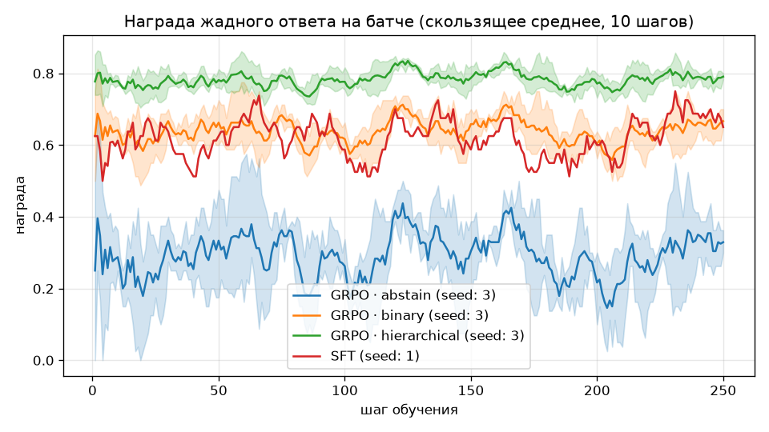
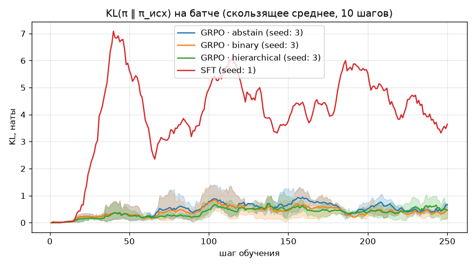
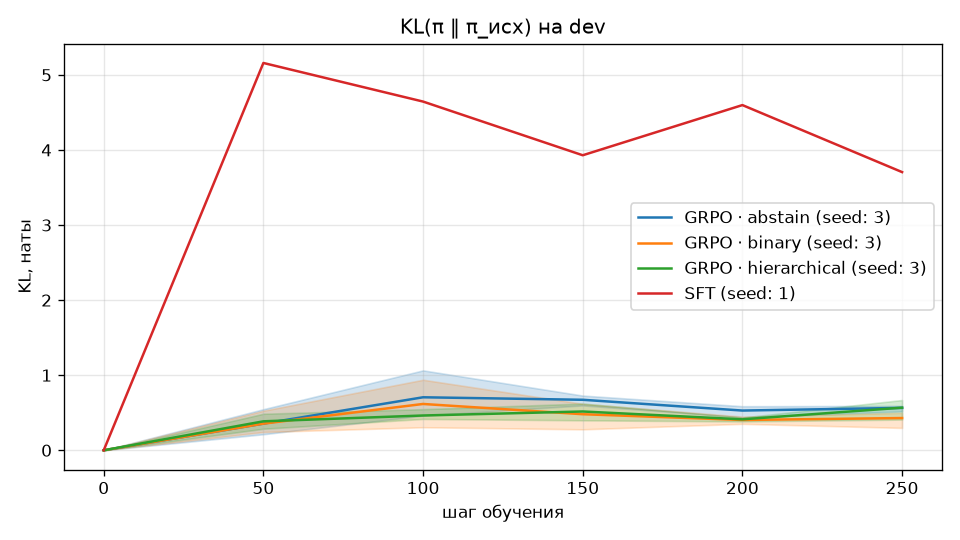
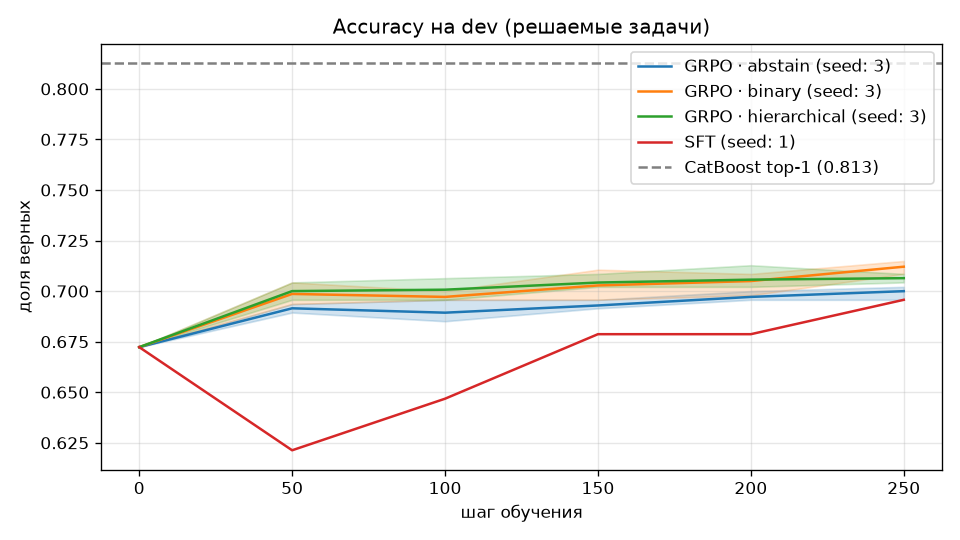
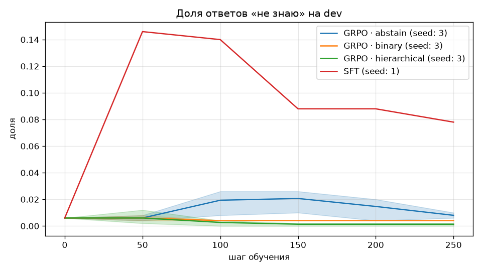
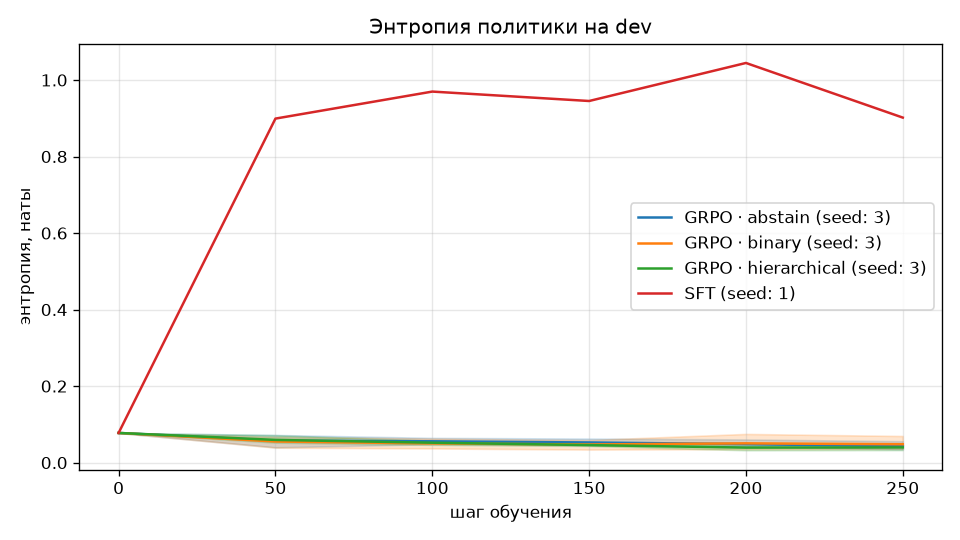

# Результаты

Все цифры — отложенная выборка, жадный ответ, последний шаг обучения. Accuracy и
доли по ветке считаются на решаемых задачах (верный код есть среди показанных),
«не знаю» и точность ответов — на всех. Для обученных условий «среднее ± стандартное
отклонение по seed» (ddof=1), в столбце seed — число запусков. Базовая модель и
CatBoost от seed не зависят. На графиках линия — среднее по seed, полоса — min..max.

## Итоговое сравнение

| условие | seed | accuracy | та же ветка | «не знаю» | точность ответов | «не знаю» без верного | согласие с CatBoost | энтропия | KL к исходной |
|---|---|---|---|---|---|---|---|---|---|
| базовая модель | — | 0.676 | 0.816 | 0.011 | 0.618 | 0.021 | 0.652 | 0.065 | 0.000 |
| CatBoost top-1 | — | 0.822 | — | — | — | — | — | — | — |
| GRPO · abstain | 3 | 0.710 ± 0.003 | 0.828 ± 0.001 | 0.012 ± 0.004 | 0.649 ± 0.003 | 0.021 ± 0.010 | 0.670 ± 0.001 | 0.048 ± 0.006 | 0.533 ± 0.049 |
| GRPO · binary | 3 | 0.710 ± 0.004 | 0.833 ± 0.003 | 0.006 ± 0.001 | 0.646 ± 0.004 | 0.007 ± 0.003 | 0.671 ± 0.001 | 0.049 ± 0.008 | 0.407 ± 0.109 |
| GRPO · hierarchical | 3 | 0.710 ± 0.004 | 0.831 ± 0.001 | 0.002 ± 0.001 | 0.643 ± 0.003 | 0.000 ± 0.000 | 0.667 ± 0.004 | 0.042 ± 0.004 | 0.635 ± 0.255 |
| SFT | 1 | 0.696 | 0.807 | 0.052 | 0.664 | 0.151 | 0.685 | 0.923 | 3.874 |

## По срезам: сколько примеров у верного класса в train каскада

| условие | только эталон | 1–4 примера | 5+ примеров |
|---|---|---|---|
| n задач | 203 | 424 | 1181 |
| CatBoost top-1 | 0.729 | 0.731 | 0.870 |
| базовая модель | 0.773 | 0.750 | 0.633 |
| GRPO · abstain | 0.796 ± 0.003 | 0.785 ± 0.004 | 0.668 ± 0.004 |
| GRPO · binary | 0.788 ± 0.013 | 0.778 ± 0.002 | 0.671 ± 0.007 |
| GRPO · hierarchical | 0.800 ± 0.012 | 0.785 ± 0.003 | 0.668 ± 0.004 |
| SFT | 0.813 | 0.769 | 0.650 |

## По месту верного кода у CatBoost

Первый столбец — задачи, где CatBoost и так прав; остальные — где судья может его поправить.

| условие | у CatBoost 1-й | у CatBoost 2-й | у CatBoost 3-й | у CatBoost 4-й | у CatBoost 5-й |
|---|---|---|---|---|---|
| n задач | 1486 | 205 | 66 | 35 | 16 |
| CatBoost top-1 | 1.000 | 0.000 | 0.000 | 0.000 | 0.000 |
| базовая модель | 0.730 | 0.459 | 0.394 | 0.371 | 0.312 |
| GRPO · abstain | 0.763 ± 0.003 | 0.519 ± 0.006 | 0.374 ± 0.017 | 0.391 ± 0.044 | 0.312 ± 0.000 |
| GRPO · binary | 0.763 ± 0.003 | 0.512 ± 0.010 | 0.384 ± 0.017 | 0.371 ± 0.029 | 0.333 ± 0.036 |
| GRPO · hierarchical | 0.764 ± 0.005 | 0.515 ± 0.003 | 0.359 ± 0.032 | 0.381 ± 0.059 | 0.354 ± 0.036 |
| SFT | 0.751 | 0.522 | 0.348 | 0.314 | 0.125 |

## По месту верного ответа в промпте

Кандидаты перемешаны, верный ответ стоит на каждом месте примерно одинаково часто.
Если accuracy сильно зависит от места, модель выбирает по позиции, а не по тексту.

| условие | на месте 1 | на месте 2 | на месте 3 | на месте 4 | на месте 5 |
|---|---|---|---|---|---|
| n задач | 353 | 370 | 322 | 382 | 381 |
| CatBoost top-1 | 0.816 | 0.819 | 0.876 | 0.783 | 0.824 |
| базовая модель | 0.462 | 0.797 | 0.748 | 0.720 | 0.653 |
| GRPO · abstain | 0.693 ± 0.017 | 0.774 ± 0.013 | 0.743 ± 0.013 | 0.690 ± 0.011 | 0.655 ± 0.020 |
| GRPO · binary | 0.648 ± 0.033 | 0.768 ± 0.003 | 0.747 ± 0.019 | 0.709 ± 0.010 | 0.680 ± 0.025 |
| GRPO · hierarchical | 0.696 ± 0.071 | 0.778 ± 0.008 | 0.733 ± 0.025 | 0.695 ± 0.009 | 0.651 ± 0.018 |
| SFT | 0.739 | 0.692 | 0.686 | 0.675 | 0.690 |

Как часто модель называет каждую цифру (все задачи, «0» — «не знаю»):

| условие | «0» | «1» | «2» | «3» | «4» | «5» |
|---|---|---|---|---|---|---|
| базовая модель | 0.011 | 0.121 | 0.284 | 0.203 | 0.211 | 0.170 |
| GRPO · abstain | 0.012 ± 0.004 | 0.206 ± 0.008 | 0.252 ± 0.011 | 0.179 ± 0.009 | 0.189 ± 0.006 | 0.163 ± 0.007 |
| GRPO · binary | 0.006 ± 0.001 | 0.187 ± 0.015 | 0.249 ± 0.001 | 0.183 ± 0.013 | 0.201 ± 0.008 | 0.174 ± 0.009 |
| GRPO · hierarchical | 0.002 ± 0.001 | 0.209 ± 0.032 | 0.256 ± 0.008 | 0.178 ± 0.012 | 0.192 ± 0.005 | 0.164 ± 0.007 |
| SFT | 0.052 | 0.238 | 0.204 | 0.152 | 0.175 | 0.178 |

## Из чего состоят ошибки

| условие | ошибок | сосед по ветке | другая ветка | «не знаю» |
|---|---|---|---|---|
| базовая модель | 585 | 0.432 | 0.538 | 0.029 |
| GRPO · abstain | 524 | 0.407 ± 0.009 | 0.557 ± 0.010 | 0.036 ± 0.010 |
| GRPO · binary | 525 | 0.423 ± 0.002 | 0.554 ± 0.002 | 0.022 ± 0.002 |
| GRPO · hierarchical | 525 | 0.419 ± 0.006 | 0.574 ± 0.004 | 0.008 ± 0.002 |
| SFT | 549 | 0.366 | 0.497 | 0.137 |

| условие | позиция | верный класс | ответ модели | ветка |
|---|---|---|---|---|
| GRPO · abstain | кран шаровой 11б27фт1 м с америк. баб. вр/нр du20  | краны шаровые муфтовые латунные 11б27п1 d20 мм | ✗ краны шаровые стальные фланцевые полнопроходные d20 мм | другая |
| GRPO · abstain | труба корсис pr2 dn/od 400 p sn8 l6 | труба из полиэтилена гофрированная двухслойная кор | ✗ труба из полиэтилена гофрированная двухслойная корсис dn/od4 | другая |
| GRPO · abstain | клапан пк50 ц исп.01 | вентили пожарные бронзовые мб1б 1р t 50 град. d50  | ✗ клапаны обратные межфланцевые стальные дисковые ком-50 | другая |
| GRPO · abstain | тройник нк пп 110/110x87 рыжий ртп / код окрб 22.2 | тройник из полипропилена пп с углом 87 градусов дл | ✗ тройник с раструбом в комплекте с резиновыми уплотнительными | другая |
| GRPO · abstain | бетон бсгт с30/37 f200 w6 п2 щ.40 | бетоны тяжелые с крупностью заполнителя 20-40 мм к | ✗ бетон тяжелый с крупностью заполнителя более 10 до 20 мм кла | другая |
| GRPO · binary | кран шаровой 11б27фт1 м с америк. баб. вр/нр du20  | краны шаровые муфтовые латунные 11б27п1 d20 мм | ✗ краны шаровые стальные фланцевые полнопроходные d20 мм | другая |
| GRPO · binary | труба корсис pr2 dn/od 400 p sn8 l6 | труба из полиэтилена гофрированная двухслойная кор | ✗ труба из полиэтилена гофрированная двухслойная корсис dn/od4 | другая |
| GRPO · binary | болт шестигранный м16x180 фас цинк класс прочности | болты оцинкованные диаметром резьбы 16-18 мм класс | ✗ болты с шестигранной головкой диаметром резьбы 16-мм | другая |
| GRPO · binary | клапан пк50 ц исп.01 | вентили пожарные бронзовые мб1б 1р t 50 град. d50  | ✗ клапаны обратные межфланцевые стальные дисковые ком-50 | другая |
| GRPO · binary | тройник нк пп 110/110x87 рыжий ртп / код окрб 22.2 | тройник из полипропилена пп с углом 87 градусов дл | ✗ тройник с раструбом в комплекте с резиновыми уплотнительными | другая |
| GRPO · hierarchical | кран шаровой 11б27фт1 м с америк. баб. вр/нр du20  | краны шаровые муфтовые латунные 11б27п1 d20 мм | ✗ краны шаровые стальные фланцевые полнопроходные d20 мм | другая |
| GRPO · hierarchical | труба корсис pr2 dn/od 400 p sn8 l6 | труба из полиэтилена гофрированная двухслойная кор | ✗ труба из полиэтилена гофрированная двухслойная корсис dn/od4 | другая |
| GRPO · hierarchical | клапан пк50 ц исп.01 | вентили пожарные бронзовые мб1б 1р t 50 град. d50  | ✗ клапаны обратные межфланцевые стальные дисковые ком-50 | другая |
| GRPO · hierarchical | тройник нк пп 110/110x87 рыжий ртп / код окрб 22.2 | тройник из полипропилена пп с углом 87 градусов дл | ✗ тройник с раструбом в комплекте с резиновыми уплотнительными | другая |
| GRPO · hierarchical | бетон бсгт с30/37 f200 w6 п2 щ.40 | бетоны тяжелые с крупностью заполнителя 20-40 мм к | ✗ бетон тяжелый с крупностью заполнителя более 10 до 20 мм кла | другая |
| SFT | кран шаровой 11б27фт1 м с америк. баб. вр/нр du20  | краны шаровые муфтовые латунные 11б27п1 d20 мм | 0 (не знаю) | — |
| SFT | труба корсис pr2 dn/od 400 p sn8 l6 | труба из полиэтилена гофрированная двухслойная кор | ✗ труба из полиэтилена гофрированная двухслойная корсис dn/od4 | другая |
| SFT | клапан пк50 ц исп.01 | вентили пожарные бронзовые мб1б 1р t 50 град. d50  | 0 (не знаю) | — |
| SFT | тройник нк пп 110/110x87 рыжий ртп / код окрб 22.2 | тройник из полипропилена пп с углом 87 градусов дл | ✗ тройник с раструбом в комплекте с резиновыми уплотнительными | другая |
| SFT | бетон бсгт с30/37 f200 w6 п2 щ.40 | бетоны тяжелые с крупностью заполнителя 20-40 мм к | ✗ бетон тяжелый с крупностью заполнителя 10 мм и менее класса  | другая |

## Ответы моделей на одних и тех же задачах

| позиция | верный класс | базовая | GRPO · abstain | GRPO · binary | GRPO · hierarchical | SFT |
|---|---|---|---|---|---|---|
| клапан отсечной угловой du15 пласт. крышка | клапаны радиаторные регулирующие с ручным маховико | ✗ клапаны запорно-присоединительные rlv d15 мм угловые | ✗ клапаны запорно-присоединительные rlv d15 мм угловые | ✗ клапаны запорно-присоединительные rlv d15 мм угловые | ✗ клапаны запорно-присоединительные rlv d15 мм угловые | 0 (не знаю) |
| рсгп для стяжек цементная м100 пк2 f100 st-2 стб13 | растворы кладочные тяжелые цементные марки 100 | ✗ растворная смесь готовая к применению кладочная цементная ма | ✗ растворные смеси предварительного изготовления кладочные цем | ✗ растворные смеси предварительного изготовления кладочные цем | ✗ растворные смеси предварительного изготовления кладочные цем | ✗ растворные смеси предварительного изготовления кладочные цем |
| бетон тяжелый с крупностью заполнителя 5-20 мм кла | бетоны тяжелые с крупностью заполнителя более 5 до | ✓ бетоны тяжелые с крупностью заполнителя более 5 до 20 мм кла | ✓ бетоны тяжелые с крупностью заполнителя более 5 до 20 мм кла | ✓ бетоны тяжелые с крупностью заполнителя более 5 до 20 мм кла | ✓ бетоны тяжелые с крупностью заполнителя более 5 до 20 мм кла | 0 (не знаю) |
| планка снегозадержателя /0.5-пэ-ral9003 /01- | планка снегозадержателя снегоупор размером от 65x9 | ✗ планка снегозадержателя снегоупор размером от 65x95 мм до 70 | ✗ планка снегозадержателя снегоупор размером от 65x95 мм до 70 | ✗ планка снегозадержателя снегоупор размером от 65x95 мм до 70 | ✗ планка снегозадержателя снегоупор размером от 65x95 мм до 70 | ✗ планка снегозадержателя снегоупор размером от 65x95 мм до 70 |
| п/п тройник комб. вр 25x1/2 meerplast | тройник из полипропилена пп тип 3 с внутренней рез | ✗ тройник из полипропилена пп тип 3 с наружной резьбой dn25x1/ | ✓ тройник из полипропилена пп тип 3 с внутренней резьбой dn25x | ✓ тройник из полипропилена пп тип 3 с внутренней резьбой dn25x | ✓ тройник из полипропилена пп тип 3 с внутренней резьбой dn25x | ✓ тройник из полипропилена пп тип 3 с внутренней резьбой dn25x |
| радиатор лу 21-315 | радиаторы отопительные стальные панельные двухрядн | ✗ радиаторы отопительные стальные панельные двухрядные с двумя | 0 (не знаю) | ✗ радиаторы отопительные стальные панельные двухрядные с одним | ✗ радиаторы отопительные стальные панельные двухрядные с одним | 0 (не знаю) |
| рспи кладочная цементная м200 пк2 st-1 | растворные смеси предварительного изготовления кла | ✗ растворы кладочные тяжелые цементные марки 200 | ✗ растворы кладочные тяжелые цементные марки 200 | ✓ растворные смеси предварительного изготовления кладочные цем | ✗ растворы кладочные тяжелые цементные марки 200 | ✗ растворы кладочные тяжелые цементные марки 200 |
| форзиция европейская высота 0.4-0.7 м | саженцы кустарников лиственных пород красивоцветущ | 0 (не знаю) | 0 (не знаю) | 0 (не знаю) | ✗ саженцы кустарников хвойных пород высокорослые | 0 (не знаю) |
| крпу-175/35 | кирпич керамический рядовой пустотелый утолщенный  | ✗ кирпич силикатный лицевой утолщенный полуторный полнотелый м | ✗ кирпич силикатный рядовой утолщенный полуторный полнотелый м | ✗ кирпич силикатный рядовой утолщенный полуторный полнотелый м | ✗ кирпич силикатный рядовой утолщенный полуторный полнотелый м | ✗ кирпич силикатный рядовой утолщенный полуторный полнотелый м |
| конвектор новатерм нт-в-11/40/120 | конвекторы внутрипольные стальные с медно-алюминие | ✓ конвекторы внутрипольные стальные с медно-алюминиевыми тепло | ✓ конвекторы внутрипольные стальные с медно-алюминиевыми тепло | ✗ конвекторы внутрипольные стальные с медно-алюминиевыми тепло | ✓ конвекторы внутрипольные стальные с медно-алюминиевыми тепло | 0 (не знаю) |
| отвод пэ компресс dn20x90гр ру16 valfex | угольник 90 градусов из полипропилена пп тип 3 ном | 0 (не знаю) | 0 (не знаю) | 0 (не знаю) | ✓ угольник 90 градусов из полипропилена пп тип 3 номинальным d | 0 (не знаю) |
| бсгт с20/25 st-2 f150-f200 w8 фр 10-20 | бетон тяжелый с крупностью заполнителя более 10 до | ✓ бетон тяжелый с крупностью заполнителя более 10 до 20 мм кла | ✗ бетон тяжелый с крупностью заполнителя более 10 до 20 мм кла | ✗ бетон тяжелый с крупностью заполнителя более 10 до 20 мм кла | ✗ бетон тяжелый с крупностью заполнителя более 10 до 20 мм кла | ✗ бетон тяжелый с крупностью заполнителя более 10 до 20 мм кла |
| бетон бсгт с30/37 f200 w6 п2 щ.40 | бетоны тяжелые с крупностью заполнителя 20-40 мм к | ✗ бетон тяжелый с крупностью заполнителя более 10 до 20 мм кла | ✗ бетон тяжелый с крупностью заполнителя более 10 до 20 мм кла | ✗ бетон тяжелый с крупностью заполнителя более 10 до 20 мм кла | ✗ бетон тяжелый с крупностью заполнителя более 10 до 20 мм кла | ✗ бетон тяжелый с крупностью заполнителя 10 мм и менее класса  |
| сталь арматурная горячекатаная гладкая для железоб | сталь арматурная горячекатаная гладкая для железоб | ✗ сталь арматурная горячекатаная гладкая для железобетонных ко | ✗ заготовки из горячекатаной арматурной гладкой стали класса s | ✗ сталь арматурная горячекатаная гладкая для железобетонных ко | ✗ заготовки из горячекатаной арматурной гладкой стали класса s | ✗ заготовки из горячекатаной арматурной гладкой стали класса s |
| пи-тройник угловой ст-штуцер 159x4.5-108x4 тс-592- | пи-тройник угловой ст-штуцер 159x4.5-108x4-отвод 4 | ✓ пи-тройник угловой ст-штуцер 159x4.5-108x4-отвод 45-108x4-/9 | ✓ пи-тройник угловой ст-штуцер 159x4.5-108x4-отвод 45-108x4-/9 | ✗ пи-тройник угловой ст-штуцер 159x4.5-108x4-отвод 45-108x4-/9 | ✗ пи-тройник угловой ст-штуцер 159x4.5-108x4-отвод 45-108x4-/9 | ✗ пи-тройник угловой ст-штуцер 159x4.5-108x4-отвод 45-108x4-/9 |

## Графики

Длина ответа у всех условий постоянна — одна цифра (`completion_tokens: 1` в
metrics.jsonl), поэтому вместо неё показаны энтропия и доля «не знаю».

